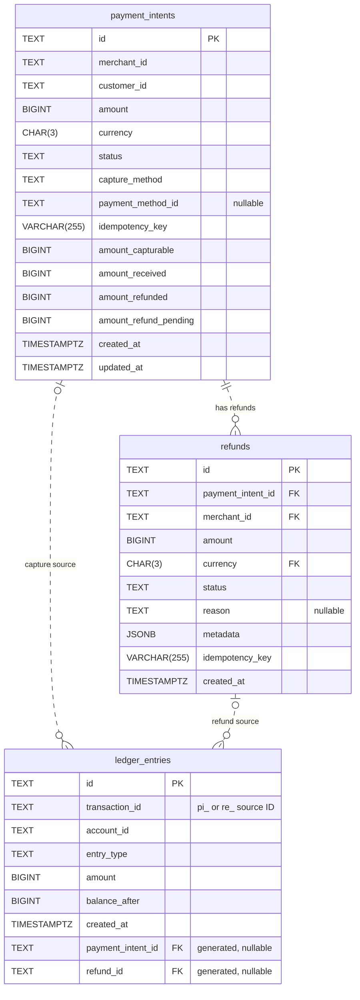
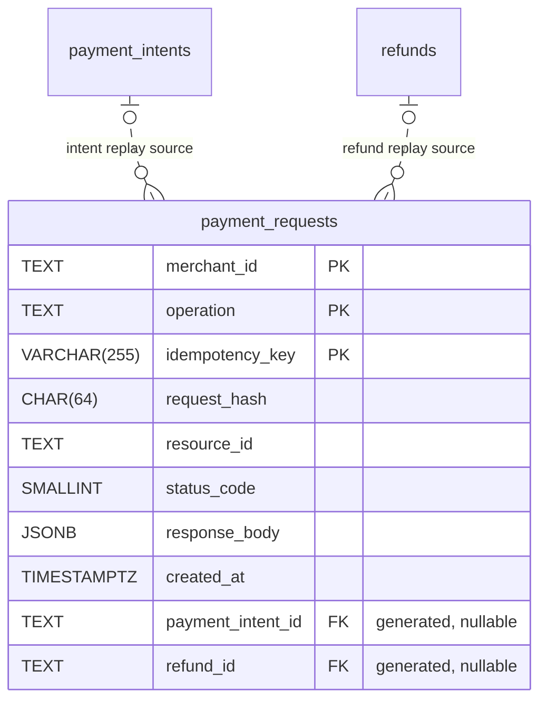

# Payments API contract

The contract defines six PaymentIntent operations and three Refund operations for issue #2.
The URL prefix is `/v1`. The path keys do not include this prefix.

## Files

- `payment_intents.yaml` defines the PaymentIntent operations.
- `refunds.yaml` defines the Refund operations.
- `schemas.yaml` defines the request and response models.

The contract references the shared headers, pagination parameters, and ProblemDocument.
The x-responses section in payment_intents.yaml defines the named error responses.
Both path files reference those responses.
The `x-retrieve`, `x-confirm`, `x-capture`, and `x-cancel` fields store reusable path items.
Their references make the operations available at the paths listed below.

## Integration

The root specification `api/openapi.yaml` references all Payments path items directly.
It uses `/v1` as the server prefix. These entries connect the additional path items:

```yaml
/payment-intents/{id}:
  $ref: "./payments/payment_intents.yaml#/x-retrieve"
/payment-intents/{id}/confirm:
  $ref: "./payments/payment_intents.yaml#/x-confirm"
/payment-intents/{id}/capture:
  $ref: "./payments/payment_intents.yaml#/x-capture"
/payment-intents/{id}/cancel:
  $ref: "./payments/payment_intents.yaml#/x-cancel"
/refunds:
  $ref: "./payments/refunds.yaml"
/refunds/{id}:
  $ref: "./payments/refunds.yaml#/x-retrieve"
```

The build bundles `api/openapi.yaml` directly.
The root file is the common entrypoint for lint, code generation, and documentation.
The new contract replaces the old stub-only 501 response.

## Contract rules

- Creation requires an Idempotency-Key with 1 to 255 characters.
- An identical creation retry returns the original status and response body.
- Automatic confirmation captures the full amount.
- Manual confirmation requires a separate full capture.
- Cancellation is permitted before capture.
- A refund requires a captured payment.
- Pending and successful refunds cannot exceed the captured amount.
- Cursor IDs must match the collection and active filters.
- The default limit is 10. The maximum limit is 100.
- Each operation describes the required permission scope.
- Valid credentials without that permission receive 403.
- List filters with no matches return an empty list.

The YAML descriptions contain the full state rules and examples.
The runtime and verification sections describe the integrated Payments implementation.

## PostgreSQL schema

`database/migrations/002_payments.sql` creates the three Payments tables.
The path matches the PostgreSQL initialization mount in the infrastructure pull request.
Apply this migration once with the database migration owner:

```sh
psql -v ON_ERROR_STOP=1 -d "$DATABASE_URL" -f database/migrations/002_payments.sql
```

### Entity relationship diagram

This diagram shows the tables and foreign keys in the migration.
Each table has its own primary key.



- Each refund belongs to exactly one PaymentIntent.
- The refund uses one composite foreign key: `(payment_intent_id, merchant_id, currency)`.
  It references `(id, merchant_id, currency)` in `payment_intents`.
- Each ledger entry references exactly one source: a PaymentIntent or a Refund.
  The two optional source relationships are mutually exclusive.
- The database generates both ledger foreign-key columns from `transaction_id`.
  A `pi_` ID sets `payment_intent_id`. A `re_` ID sets `refund_id`.
  The application does not supply these generated columns.
- `merchant_id` and `customer_id` have no foreign keys to Identity yet.
  `account_id` has no foreign key because this migration does not define an accounts table.

| Table | Additional unique keys |
| --- | --- |
| `payment_intents` | `(merchant_id, idempotency_key)` and `(id, merchant_id, currency)` |
| `refunds` | `(merchant_id, idempotency_key)` |
| `ledger_entries` | `(transaction_id, account_id, entry_type)` |

The migration creates a NOLOGIN permission group named `stripe_lite_payments_app`.
Grant that group to the application login during deployment.
The application login must not own the tables or have superuser privileges.
Ledger rows permit SELECT and INSERT only. Triggers also reject UPDATE, DELETE, and TRUNCATE.
A capture or successful refund must post balanced ledger entries in the same database transaction.
Each side must equal the source amount. A posting must use at least two accounts.
The balance checks run at commit. A single-sided posting cannot commit.

Refund creation reserves its amount under a lock on the parent payment.
A successful refund moves the reservation into the refunded total.
A failed refund releases its reservation. Applications cannot update these totals directly.
Refunds derive merchant and currency from their parent payment.
Idempotency keys are unique per merchant and creation operation.
Migration 003 and the service store request hashes and original responses.

Merchant and customer IDs use TEXT until the Identity schema is available.
Cross-domain foreign keys need agreement on the Identity ID types.
The migration does not create placeholder Identity tables.
The account ID identifies an external ledger account.
The service must validate account ownership and currency and calculate balance_after under an account lock.
This migration does not define account records or processor integration.

## Runtime and verification

The build reads the path references and `/v1` prefix directly from `api/openapi.yaml`.
It writes the bundled specification to `dist/openapi.bundled.yaml`.
The bundled specification, generated server, and Swagger UI use `/v1`.
The generated server implements all nine Payments operations.
Identity and Webhooks retain their existing handlers.

Apply `database/migrations/003_payment_requests.sql` after migration 002.
This table stores request hashes and the original successful creation responses.
Each key belongs to one merchant and one creation operation.
A transaction lock rejects a concurrent request with the same key.
The response and resource commit in one database transaction.
The API can replay the original response after a process restart.
A retry of a refund without `amount` uses the original resolved amount.



Exactly one generated source column is set in each request record.
The application role can read and insert these records. It cannot change or delete them.

### Configuration

| Variable | Use |
| --- | --- |
| `DATABASE_URL` | PostgreSQL connection for the restricted application login. |
| `PAYMENTS_API_KEYS` | JSON array of `key`, `merchant_id`, and `scopes`. Keys require at least 32 characters. |
| `PAYMENTS_JWT_SECRET` | Optional HS256 verification secret with at least 32 bytes. |
| `PAYMENTS_JWT_ISSUER` | Required issuer when JWT verification is configured. |
| `PAYMENTS_JWT_AUDIENCE` | Required audience when JWT verification is configured. |
| `PAYMENTS_RATE_LIMIT` | Requests per merchant per minute in this process. The default is 120. |
| `PAYMENTS_PROCESSOR` | Set `simulated` to enable the development processor and customer directory. |
| `PAYMENTS_DEMO_MERCHANT_ID` | Development merchant. The default is `merchant_demo`. |
| `PAYMENTS_DEMO_CUSTOMER_ID` | Development customer. The default is `cus_demo`. |

API keys and JWTs must contain the scopes listed in the operation descriptions.
JWTs also require `merchant_id`, `exp`, `iss`, and `aud` claims.
The `scope` claim contains space-separated scopes.
Missing credentials receive 401. Missing permission receives 403.
Credential verification does not issue tokens or change the Identity endpoints.
The rate limit is local to one process. A shared limiter is required for multiple replicas.

The normal customer adapter reads Identity-owned `customers` and `payment_methods` tables.
Both tables need an `id` and `merchant_id`. Payment methods also need a `customer_id`.
Give the application login SELECT access when Identity supplies those tables.
The adapter returns 503 if the tables or required permissions are unavailable.
It returns 404 if the customer or method belongs to another merchant.
This migration does not create Identity tables.

The development adapter accepts only the configured merchant and customer.
Its payment methods are `pm_demo`, `pm_declined`, `pm_unavailable`, and `pm_refundfailed`.
They model success, authorization decline, temporary failure, and refund failure.
The simulated processor never moves real funds.
The server rejects it when `APP_ENV=production`.
No real processor adapter is included in Sprint 1.
Payment confirmation requires an explicitly configured processor.
A future adapter must support the stable operation keys supplied by the service.
It must distinguish a confirmed failure from an unknown financial outcome.
Unknown errors return 500. They must be reconciled before another financial attempt.

The refund worker checks pending refunds each second.
It locks the payment before the refund and uses a stable refund operation key.
Multiple workers cannot settle the same refund twice.
Capture debits the clearing account and credits the merchant account.
Refunds reverse these entries.
Account IDs derive from the merchant, currency, and account type.
The service locks both accounts in a fixed order before it calculates balances.
`balance_after` uses credit minus debit. Each value must fit in BIGINT.

Run the acceptance checks from the repository root:

```sh
make lint-spec
make lint-redocly
make codegen
make test
make test-integration
make verify
```

`make test` runs unit and contract tests with the race detector. It does not need Docker or PostgreSQL.
Database tests use the `integration` build tag and run with `make test-integration`.
The alias `make test-intergration` runs the same target.
This target runs the unit tests and PostgreSQL tests together.
It creates a disposable PostgreSQL 16 container and a restricted application login.
It applies both migrations and removes the container when the checks finish.
To use an existing disposable database, set both `PAYMENTS_TEST_DATABASE_URL` and `PAYMENTS_TEST_ADMIN_URL`.
The admin connection is needed only for schema and permission checks.

`make verify` runs gateway smoke tests without PostgreSQL or Docker.
It needs Bash and curl, plus the normal shell utilities. It does not need jq or OpenSSL in smoke mode.
The checks cover health probes, Swagger UI, JSON/YAML specifications, a problem+json 404, and the Auth/Webhooks 501 stubs.
All six Webhooks routes and all Payments path references remain in the combined specification.
The script does not invoke Docker or create a database.

Set `PAYMENTS_TEST_DATABASE_URL` to enable the full Payments assertions after the smoke tests.
That URL must point to a disposable test database with both migrations applied.
This mode also needs jq and OpenSSL. It fails if the supplied database is unavailable.
It checks all nine Payments operations, the asynchronous worker, original response replay, and exact int64 amounts.
To provision PostgreSQL explicitly for this check, run:

```sh
./scripts/with-test-db.sh make verify
```

Set `VERIFY_PORT` to choose a server port. Otherwise, the script chooses a random high port.
The integration tests validate response bodies and headers against the OpenAPI contract.
The database tests check concurrent refunds, capture versus cancel, and immutable ledger permissions.
